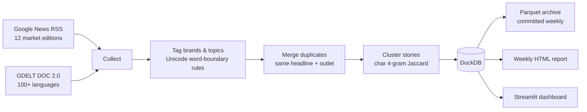

# PR Radar

Tracks news coverage of a brand and its competitors in 12 Google News market editions (GDELT is optional). A weekly report shows:

- **Share of voice** against competitors, and the change since the previous week.
- **Market gaps:** markets where a competitor gets more coverage.
- **Pitch targets:** outlets that covered competitors but not the brand. Outlets that covered the brand before are marked.
- **Topic gaps:** topics (launches, deals, gift guides, skin science...) that take a larger share of competitor coverage.
- **Headline tone and risk alerts:** valence/arousal per brand mention (DimABSA model) and keyword alerts for recalls, lawsuits and similar.

A small local LLM also writes a short weekly brief from these numbers. The brief is checked against the data before it is published.

Outputs: a weekly HTML report (built and published to GitHub Pages by a scheduled GitHub Action), a static web dashboard and a Streamlit app.

> Independent student project, not affiliated with or endorsed by any brand named in the configuration or reports. It uses only public news headlines and metadata. The brands in `config/brands.yaml` are a demo; edit the file to track another market. Matching is automatic and can be wrong, so check a report before sharing it.

## How it works



| Step | What happens | Why |
|---|---|---|
| Collect | One Google News search feed per brand × market edition, plus an optional GDELT query per brand. Polite per-host rate limiting, retries, and cool-downs on HTTP 429. | Google News gives market-specific visibility; GDELT adds global, non-English sources. |
| Tag | Brands named in the headline are added to the brand whose query found the article. Topics come from a multilingual keyword taxonomy (EN/DE/FR/ES/IT/PL/TR/SV/JA/PT). | One article can mention several brands, and head-to-head coverage matters. |
| Merge | The same headline from the same outlet is one article, whichever collector or edition found it. | Without this, one article shows up in up to 12 editions and inflates share of voice. |
| Cluster | Syndicated copies of a story across outlets are grouped with character 4-gram Jaccard similarity, which also works for languages without spaces (Japanese). | **Mentions** count placements; **stories** count distinct news events. |
| Store | DuckDB for fast local analytics. Every run also writes the rows it touched to `data/archive/*.parquet`. | The weekly GitHub Action commits these small files, so history survives with no database server, and a fresh clone rebuilds the database from them. |

## How it compares

Commercial media-monitoring platforms (Meltwater, Cision, Onclusive, Muck Rack, Brandwatch, Talkwalker, Brand24 and others) have licensed and paywalled content, broadcast and print, social media, audience-reach estimates and journalist databases. PR Radar only reads public news headlines. The differences:

| | Typical commercial platform | PR Radar |
|---|---|---|
| Sources | Licensed news, broadcast, print, social | Public news headlines (Google News, GDELT) |
| Main output | Mention dashboards and search | A weekly to-do list: outlets to pitch, warm contacts, markets and narratives where competitors lead |
| Sentiment | Usually one positive/negative/neutral label per article | Valence and arousal per brand mention in a headline (DimABSA) |
| Customisation | Vendor-defined categories | Brands, markets and topic taxonomy in one YAML file |
| Data ownership | Inside the vendor's platform | Parquet files and SQL (DuckDB) in your own repository |
| Cost | Paid subscription | Free and open source; runs on GitHub Actions |

**Missing:** headlines only (no full text yet), no social or broadcast coverage, no reach or audience metrics, and no journalist-level contact data.

## Quick start

```bash
python -m venv .venv
source .venv/bin/activate          # Windows: .venv\Scripts\activate
pip install -e ".[dashboard,dev]"

pr-radar -v collect                # a few minutes: rate-limited on purpose (see below)
pr-radar stats                     # share of voice + key takeaways in the terminal
pr-radar report                    # reports/weekly-YYYY-Www.html
pr-radar dashboard                 # interactive Streamlit app
```

Options: `--config`, `--db`, `--archive`, `collect --skip gdelt`, `report --days 14 --end 2026-11-20 --publish docs/index.html`.

## Web dashboard

A static, dark "glass" dashboard lives in `web/` (plain HTML, CSS and JavaScript, no build step):

```bash
pr-radar export-web                # writes web/data.json (+ web/data.js) for the last 7 and 28 days
python -m http.server 8766 --directory web   # or just open web/index.html
```

It shows the headline KPIs with a 7 / 28-day switch, key takeaways, share of voice with a weekly split, market gaps, pitch targets (warm contacts highlighted), narrative gaps by topic, the most syndicated stories, and headline tone per brand (DimABSA). `export-web` only reads, so it opens an existing database read-only. `data.js` carries the same payload as `data.json` so the page also works from `file://`. Drop a background render at `web/assets/hero.webp` and it replaces the CSS swirl automatically. The weekly HTML report uses the same visual language and switches to a plain ink-friendly layout when printed.

## Headline sentiment (DimABSA)

PR Radar scores how each headline talks about every brand it names, with continuous **valence** (1 very negative · 5 neutral · 9 very positive) and **arousal** (1 calm · 9 intense), following SemEval-2026 Task 3, *Dimensional Aspect-Based Sentiment Analysis*.

**Model.** `xlm-roberta-base` with a two-value regression head, input = (aspect, text). It was trained jointly on all 36,435 aspect pairs of the official data (English, Japanese, Russian, Tatar, Ukrainian and Chinese; restaurant, laptop, hotel and finance reviews) in about 10 minutes on a laptop RTX 5070. The 250k-token embedding matrix is frozen: on an 8 GB GPU this cut a training step from 3.1 s to 0.08 s, because the full optimizer state no longer spills into system memory.

**Official test sets** (normalised RMSE, lower is better; baseline = always predict the training mean). Full table: [`results/dimasr_xlm-roberta-base.md`](results/dimasr_xlm-roberta-base.md)

| | eng laptop | eng restaurant | jpn hotel | zho finance | rus restaurant | tat restaurant |
|---|---:|---:|---:|---:|---:|---:|
| Model | **0.126** | **0.122** | **0.075** | **0.050** | **0.155** | **0.189** |
| Baseline | 0.200 | 0.210 | 0.137 | 0.107 | 0.202 | 0.202 |
| Pearson (valence) | 0.84 | 0.85 | 0.91 | 0.86 | 0.86 | 0.67 |

**News headlines.** DimABSA has reviews, not news, and none of PR Radar's main languages besides English. On 185 brand mentions in real beauty-tech headlines (`data/annotations/`, pre-labelled by an LLM and being verified by a human), 5-fold cross-validation gives:

| Approach | RMSE | Pearson V | Pearson A |
|---|---:|---:|---:|
| Domain mean (baseline) | 0.121 | – | – |
| DimABSA model as is | 0.171 | 0.46 | 0.35 |
| + linear calibration | 0.112 | 0.39 | 0.31 |
| **+ fine-tuning on headlines** | **0.112** | **0.53** | **0.63** |

Out of the box the model ranks headlines sensibly, but it is miscalibrated: it rates news as far more intense than it is (mean arousal 7.1 vs 5.9), because reviews are more emotional than journalism. A short fine-tune on headlines fixes the scale and improves both correlations. The adapted model (`models/dimasr-xlmr-base-news`) is the one used for scoring.

**Known limitation.** The headline set has few negative examples, and the model scored a product recall as mildly positive (5.8). Reputational risk is therefore flagged by a multilingual keyword rule (the `risk` topic: recall, lawsuit, injury, Rückruf, demanda, geri çağırma…), and sentiment is shown as indicative only.

```bash
pip install torch --index-url https://download.pytorch.org/whl/cu128   # GPU build
pip install -e ".[sentiment]"
sh scripts/fetch_dimabsa.sh        # data is research-only and not redistributable, so it is not in this repo
pr-radar dimabsa-train             # train + evaluate on the official test sets -> results/
pr-radar dimabsa-adapt             # k-fold comparison on headlines + domain-adapted model
pr-radar score-sentiment           # score new headline brand mentions
```

## Weekly brief (local LLM)

`pr-radar brief` turns the week's numbers into a short note for the PR team: two or three sentences on where the brand stands, then two to four actions that name an outlet, market or topic. It runs a small open model (Qwen3-1.7B with a LoRA adapter, committed in [`adapters/brief-lora-qwen3-1.7b`](adapters/brief-lora-qwen3-1.7b)) locally on the GPU, so no data leaves the machine and there is no API cost.

A 1.7B model will invent things if left alone, so the brief goes through these steps:

1. **Fact sheet.** The model only sees a short text sheet built from the report tables (`narrative/facts.py`). Every number is already rounded and formatted there.
2. **Checks** (`narrative/checks.py`). A brief is rejected if it:
   - contains a number, outlet, country or topic that is not in the sheet, or copies a name from the prompt example;
   - describes a change over time when there is no previous period, or skips a risk headline;
   - gets the brand's rank wrong, or names the wrong leader overall, in a market or on a topic;
   - gives advice that does not fit: "re-pitch" for an outlet that never covered the brand, an action addressed to a competitor or promoting a competitor's news, a statement when the risk headline is about someone else;
   - breaks the Summary/Actions format.

   Stock phrases ("crucial", "landscape", "it's worth noting"...), duplicate actions and "monitor"-style actions count as style issues.
3. **Retries.** The first attempt is greedy. If it fails, the model gets the list of problems and rewrites, or samples a new draft (three attempts in the evaluation, four by default). A brief that still has errors is saved to `data/briefs/` for inspection but not published; the report then shows only the rule-based takeaways.

```bash
pip install -e ".[sentiment]"      # torch + transformers
pr-radar brief --adapter adapters/brief-lora-qwen3-1.7b   # writes data/briefs/brief-<start>_<end>.json
pr-radar report                    # includes the brief if it passed the checks
```

### How the adapter was trained

The base 1.7B model with a worked example in the prompt mostly failed by copying the example (its markets, topics and "re-pitch" wording). Fine-tuning on its own best outputs (self-distillation) removed the copying but not the bad advice, because the targets had the same blind spots. So the targets now come from a larger model:

1. **Teacher data.** Qwen3-4B-Instruct-2507, loaded in 4-bit, wrote 4 candidate briefs for each of 250 synthetic weeks (random primary brand, so the adapter is not tied to FOREO). A candidate is kept only if it passes every check with no style issue; per week the one that uses the most facts wins. 42% of candidates passed and 154 weeks gave an example (`data/brief_sft/train.jsonl`).
2. **LoRA.** Rank 16 on all attention and MLP projections, 17M trainable parameters (1% of the model), 3 epochs, 10 minutes on a laptop RTX 5070 (8 GB). The training prompt has no worked example. Validation loss went from 2.94 to 0.43.
3. **Evaluation.** The real week plus 20 synthetic weeks with seeds that were never used for training. Each model's first draft is checked with the final checks (`scripts/rescore_briefs.py`) and scored 1–5 by an LLM judge (`pr-radar brief-judge`, Qwen3-4B with a rubric on whether the advice makes sense for the brand).

```bash
pr-radar brief-distill --model Qwen/Qwen3-4B-Instruct-2507 --load-4bit --weeks 250 --samples 4
pr-radar brief-train --out adapters/brief-lora-qwen3-1.7b
pr-radar brief-eval --weeks 20 --tries 3 --adapter adapters/brief-lora-qwen3-1.7b
pr-radar brief-judge results/brief_eval_brief-lora-qwen3-1.7b.json
```

`scripts/brief_pipeline.ps1` runs the whole thing (about 2.5 hours, most of it the teacher).

### Results

21 held-out weeks. Raw output with every draft and judge reply: [`results/brief_eval_*.json`](results/).

| | First draft passes every check | Published within 3 attempts | Judge mean (1–5) | Judge 4 or 5 |
|---|---:|---:|---:|---:|
| Qwen3-1.7B, worked example in prompt | 1 of 21 | –¹ | 3.52 | 43% |
| + LoRA on its own outputs | 2 of 21 | –¹ | 3.52 | 48% |
| **+ LoRA on teacher outputs (shipped)** | **11 of 21** | **86%** | **4.19** | **81%** |
| Teacher: Qwen3-4B, worked example in prompt | 10 of 21 | 81% | 4.52 | 90% |

¹ These two were run before the last checks were added, so their retry loop worked against an easier bar. Their first drafts are re-checked with the final checks above.

The adapter matches the teacher on the checks with less than half the parameters and no example in the prompt, and takes about 13 s per week in the evaluation (retries included) against 25 s. The judge still prefers the teacher. It is also more lenient than the checks (it gives the base model 3.5), and it comes from the same family as the teacher, so read it as a ranking, not an absolute score.

Errors in first drafts, final checks:

| Error | Base | Self-distilled | Teacher-distilled | Teacher |
|---|---:|---:|---:|---:|
| "Re-pitch" for an outlet that never covered the brand | 33 | 37 | 11 | 6 |
| Action addressed to a competitor | 9 | 2 | 0 | 1 |
| Copied a name or phrase from the prompt example | 9 | 0 | 0 | 1 |
| Wrong rank for the brand | 9 | 0 | 0 | 0 |
| Wrong leader for a market, topic or overall | 4 | 4 | 2 | 4 |
| Statement suggested for someone else's risk headline | 0 | 3 | 0 | 0 |
| Country not in the fact sheet | 2 | 0 | 3 | 0 |
| Number, outlet or topic not in the fact sheet | 4 | 0 | 0 | 1 |
| Action promotes a competitor's story | 1 | 1 | 0 | 1 |
| Risk headline not mentioned | 1 | 1 | 1 | 1 |

**What is left.** The main remaining error is "re-pitch", in 6 of the 21 first drafts. 98 of the 154 teacher briefs contain a re-pitch action, since every week with a warm outlet gets one, and the adapter picked that up as a habit: it writes "Re-pitch hurriyet.com.tr, which covered competitors but not FOREO". Two fixes were tried and not shipped:

- Labelling cold outlets "never covered FOREO" in the fact sheet: same 11 of 21, re-pitch errors unchanged, more competitor-story errors (`results/brief_eval_lora-cold-labels.json`).
- Training on an equal number of weeks with and without a warm outlet (`scripts/balance_brief_sft.py`, 112 examples): re-pitch errors fell from 6 to 4 drafts, but competitor-story errors rose from 0 to 3. Again 11 of 21, with 76% published against 86% and a judge mean of 4.14 (`results/brief_eval_lora-balanced.json`).

With 21 test weeks a difference of one or two drafts is within noise. The next useful steps are more teacher briefs for weeks without a warm outlet, instead of dropping examples, and a larger test set.

**What the checks do not catch.** They test whether a brief is grounded in the data and catch the bad advice seen so far, not every kind. Two patterns found by reading drafts are not checked yet: outlet names that are not domains ("The Verge"), and vague targets ("outlets that covered FOREO before, such as [outlet name]"). A brief should still be read before it is shared, and the weekly report on GitHub Pages keeps the rule-based takeaways.

## Automation

| Workflow | Trigger | What it does |
|---|---|---|
| `ci.yml` | push / PR | `ruff format --check`, `ruff check`, `pytest` |
| `weekly.yml` | Mondays 06:00 UTC + manual | collect → append to Parquet archive → build report → commit to `docs/` (GitHub Pages) |

To publish the report, enable **Settings → Pages → Deploy from branch → `main` / `docs`**.

## Project layout

```
config/brands.yaml          brands, market editions, topic taxonomy
src/pr_radar/
  collectors/               google_news.py, gdelt.py
  matching.py               brand + topic tagging
  dedup.py                  duplicate merge + story clustering
  storage.py                DuckDB + Parquet archive
  analytics.py              share of voice, market/outlet/topic gaps, sentiment, insights
  sentiment/                DimABSA data, metrics, XLM-R model, experiments, scoring
  narrative/                weekly brief: fact sheet, prompt, local LLM, checks, evaluation
  report.py, templates/     weekly HTML report (inline SVG, no JS)
  web_export.py             data.json for the static web dashboard
  dashboard.py              Streamlit app
  cli.py                    pr-radar command
tests/                      offline tests with recorded fixtures
web/                        static web dashboard (index.html, styles.css, app.js)
annotation/                 headline labelling guidelines + review tool
results/                    model evaluation tables (JSON + Markdown)
adapters/                   LoRA adapter for the brief writer (35 MB)
scripts/fetch_dimabsa.sh    downloads the DimABSA data (not redistributed)
```

## Design decisions

- **Headline-level analysis.** Feeds only carry headlines, so tagging and clustering work on titles. Full-text extraction is on the roadmap.
- **Short-text language detection.** A headline's language is detected only when the detector is ≥ 90 % confident; otherwise the edition's language is used.
- **Word boundaries.** Brand rules require whole-word matches (`FOREO` does not match "foreordained"). Topic rules match word prefixes (`sustainab` → sustainable, sustainability). Brands can also define exclusion phrases.
- **Rate limits.** The HTTP client keeps a minimum gap per host, and on HTTP 429 it waits (honouring `Retry-After`) instead of retrying immediately, because quick retries only extend a ban.
- **GDELT is optional (off by default).** It adds global, non-English sources, but it enforces one request per 5 s and can rate-limit an IP for a long time. In testing it returned no usable data across two full runs. When enabled (`gdelt.enabled: true`), it has a time budget (180 s) and stops after two failed brands, so the weekly job falls back to Google News instead of stalling.
- **Headline vs body mentions.** Google News matches a query anywhere in an article, so most mentions are in the body (gift guides, round-ups). Reports show both, and only headline mentions get sentiment scores. Outlets in `exclude_domains` are dropped from all history.
- **No fake trends on day one.** Each run only sees the last 7 days. Week-over-week deltas are shown only once the previous window has actually been collected; until then the report says "first tracked period".

## Roadmap

1. **DimABSA, next steps:** replace the LLM pre-labels with the human-reviewed set and add more negative headlines; score product-level aspects (price, design, efficacy) instead of only the brand; compare with an LLM zero-shot scorer; host the model so the weekly GitHub Action can score too (today scoring runs locally).
2. Full-text extraction (trafilatura) for better topic and sentiment coverage.
3. LLM-assisted topic classification to replace the keyword taxonomy.
4. Alerts (Slack/email) when share of voice drops sharply or a negative story spreads to many outlets.

## License

MIT
